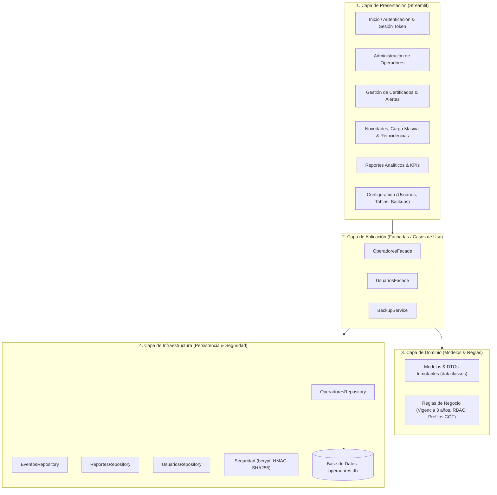
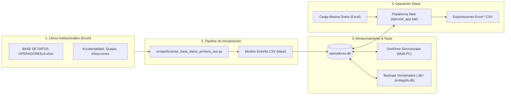

<div align="center">

# Certificado_operadores

**Plataforma institucional para la gestión del certificado de idoneidad, control de novedades normativas, analítica operativa y ciclo de vida de los operadores del sistema masivo MIO (Metrocali S.A.).**

[](./LICENSE)
[](https://conventionalcommits.org)
[](./CONTRIBUTING.md)

</div>

---

## 📖 Descripción general

Sistema web desarrollado sobre Streamlit y SQLite para centralizar y versionar la información de los conductores del sistema masivo MIO: vinculación, emisión de certificados de idoneidad, gestión de novedades de comportamiento (accidentalidad, quejas e infracciones), evaluación automática de reincidencias y analítica interactiva tridireccional.

> 📘 La verdad técnica central —stack, decisiones, convenciones y flujo— vive en
> [`CONSTITUTION.md`](./CONSTITUTION.md). De lectura obligatoria antes de operar.

---

## 📑 Tabla de contenidos

- [Descripción general](#-descripción-general)
- [Estado del proyecto](#-estado-del-proyecto)
- [Stack tecnológico](#-stack-tecnológico)
- [Arquitectura y Flujo de la Información](#-arquitectura-y-flujo-de-la-información)
- [Primeros pasos](#-primeros-pasos)
- [Calidad y automatización](#-calidad-y-automatización)
- [Estructura del repositorio](#-estructura-del-repositorio)
- [Documentación](#-documentación)
- [Flujo de trabajo y contribución](#-flujo-de-trabajo-y-contribución)
- [Licencia](#-licencia)

---

## 🚧 Estado del proyecto

| Área | Estado | Detalle |
|---|:---:|---|
| Estructura y gestor de entorno (`uv`) | ✅ | Totalmente estandarizado |
| Gobernanza y Constitución | ✅ | [`CONSTITUTION.md`](./CONSTITUTION.md) actualizado |
| Arquitectura desacoplada (Facade) | ✅ | Cero consultas SQL o lógica en UI |
| Módulos operativos y analítica visual | ✅ | Altair cross-filtering, KPIs institucionales |
| Suite de pruebas automatizadas | ✅ | **388 pruebas en verde** (`388 passed`) |

---

## 🛠️ Stack tecnológico

| Categoría | Tecnología |
|---|---|
| **Lenguaje** | Python 3.13+ |
| **Interfaz Web** | [Streamlit](https://streamlit.io/) + Componentes personalizados y CSS corporativo Metrocali |
| **Visualización** | [Altair](https://altair-viz.github.io/) (interactividad coordinada cross-filtering) |
| **Base de datos** | SQLite (`operadores.db`) con SQLAlchemy y respaldos versionados |
| **Entorno y dependencias** | [`uv`](https://docs.astral.sh/uv/) (lockfile determinista, sin pip manual) |
| **Testing** | [`pytest`](https://docs.pytest.org/) con fixtures y AppTest de UI |
| **Linting y formato** | [Ruff](https://docs.astral.sh/ruff/) |
| **CI/CD** | [GitHub Actions](.github/workflows/ci.yml) |

---

## 🏛️ Arquitectura y Flujo de la Información

### 1. Arquitectura en Capas (Patrón Facade)
La interfaz de usuario nunca ejecuta tareas ni contiene consultas a la base de datos. Toda interacción fluye estrictamente a través de Fachadas especializadas:



### 2. Flujo de Datos y Pipeline Operativo



---

## 🚀 Primeros pasos

### Requisitos previos
- [Python 3.13+](https://www.python.org/downloads/)
- [`uv`](https://docs.astral.sh/uv/getting-started/installation/)
- [Git](https://git-scm.com/)

---

### Paso 1: Clonar el Repositorio
Se recomienda clonar dentro de su carpeta institucional de **OneDrive** para habilitar la persistencia y colaboración entre equipos:

```powershell
git clone https://github.com/certificadooperadores/Certificado_operadores.git
cd Certificado_operadores
```

---

### Paso 2: Inicializar el Entorno con `uv`
Ejecute la sincronización determinista de dependencias:

```powershell
uv sync
uv run pre-commit install   # instala los hooks locales de git
```

---

### Paso 3: Inicializar la Base de Datos (Primera Vez)
Si está configurando el proyecto desde cero, deposite los libros Excel institucionales en `scripts/Archivos_excel_iniciales/` y ejecute el script unificado:

```powershell
uv run python scripts/levantar_base_datos_primera_vez.py
```
*Este proceso genera el modelo estrella normalizado, crea la base física `operadores.db` y habilita la cuenta inicial de administrador (`admin` / `admin123`).*

---

### Paso 4: Ejecutar la Aplicación

Dispone de dos formas para iniciar:

#### Opción A (Recomendada en Windows):
Haga doble clic en el archivo [ejecutar_app.bat](file:///c:/Users/maortiz/OneDrive%20-%20metrocali.gov.co/App/Certificado_operadores/ejecutar_app.bat) ubicado en la raíz del repositorio.

#### Opción B (Desde Terminal):
```powershell
uv run streamlit run src/certificado_operadores/Inicio.py
```

---

### Trabajo Colaborativo en OneDrive (Regla de Turnos)
- **Consulta y Lectura:** Múltiples computadores pueden tener abierta la plataforma simultáneamente para consultar o descargar informes.
- **Edición y Registro:** Se recomienda coordinar turnos de registro activo o esperar la confirmación de sincronización de OneDrive antes de editar, evitando conflictos en el archivo `operadores.db`.
- **Refresco:** Use el botón **🔄 Refrescar Datos** en la barra lateral para sincronizar cualquier cambio externo al instante.

---

## ✅ Calidad y automatización

| Comando | Descripción |
|---|---|
| `make help` | Lista los comandos disponibles. |
| `make dev` | `uv sync` + instalación de hooks de pre-commit. |
| `make check` | Verificación completa (lint + formato + pruebas). |
| `make lint` / `make format` | Ruff (análisis y formato de código). |
| `make test` | Pytest (ejecuta las 388 pruebas unitarias). |

---

## 📂 Estructura del repositorio

```text
Certificado_operadores/
├── src/certificado_operadores/   # Código fuente empaquetado (src-layout)
│   ├── domain/                  # Modelos y DTOs inmutables
│   ├── infra/                   # Repositorios SQLAlchemy, backup y seguridad
│   ├── modulos/                 # Vistas y componentes UI por módulo
│   ├── pages/                   # Páginas multipágina de Streamlit
│   ├── facade.py                # Fachada principal de operaciones
│   ├── facade_usuarios.py       # Fachada de control de acceso y RBAC
│   ├── estilos.py               # Tema y tokens visuales Metrocali
│   └── Inicio.py                # Entrada principal y pantalla de Login
├── tests/                       # Suite automatizada de pruebas (pytest)
├── docs/                        # Documentación técnica y manuales
├── scripts/                     # Scripts de carga inicial y utilidades
├── ejecutar_app.bat             # Lanzador rápido de la app para Windows
├── CONSTITUTION.md              # Fuente única de verdad arquitectónica
├── pyproject.toml               # Configuración del paquete y dependencias (uv)
└── README.md                    # Presentación general del proyecto
```

---

## 📚 Documentación detallada

La documentación técnica vive en [`docs/`](./docs/README.md):

| Documento | Contenido |
|---|---|
| [docs/requerimientos.md](./docs/requerimientos.md) | Requisitos de software, dependencias y hardware. |
| [docs/desacople.md](./docs/desacople.md) | Arquitectura, capas, contratos y desacoplamiento. |
| [docs/manual-usuario.md](./docs/manual-usuario.md) | Guía de uso completa y manual operativo por módulo. |
| [docs/referencia-funciones.md](./docs/referencia-funciones.md) | Inventario completo de funciones y responsabilidades. |

---

## 🤝 Flujo de trabajo y contribución

> 📘 La guía completa está en [`CONTRIBUTING.md`](./CONTRIBUTING.md).

1. Crea una rama: `git checkout -b feat/nombre-corto`.
2. Desarrolla respetando el ciclo de calidad (`make check` en verde).
3. Commitea con [Conventional Commits](https://www.conventionalcommits.org/): `git commit -m "tipo: descripción"`.
4. Abre un Pull Request con la plantilla oficial.

---

## 📄 Licencia

Distribuido bajo licencia Privada institucional. Ver [`LICENSE`](./LICENSE).

---

**Autor:** Ing. Miguel Angel Ortiz Roldan  
**Institución:** Metrocali S.A. — Dirección de Operación - Evaluación de la Operación
