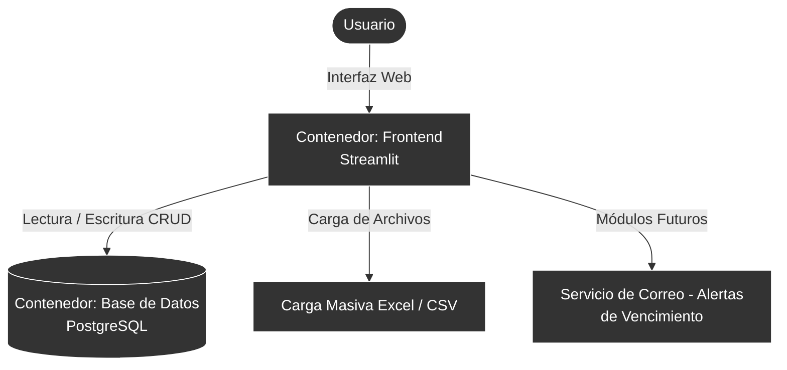
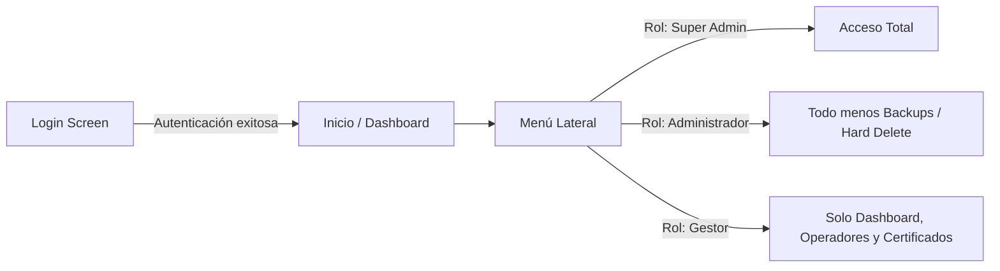

# Arquitectura y Documentación — Plataforma de Operadores v1.0

Este documento resume la arquitectura tecnológica, el diagrama de interacción de los usuarios y el modelo de datos de la solución en contenedores.

---

## 1. Tecnologías Base

| Capa | Tecnología | Descripción |
|------|-----------|-------------|
| **Frontend / UI** | **Streamlit 1.39** (Python) | Framework principal para la interfaz de usuario web. |
| **Backend / Lógica** | **Python 3.10** | Lenguaje de programación principal del proyecto. |
| **Base de Datos** | **PostgreSQL 15** (Alpine) | Motor de base de datos relacional para almacenamiento persistente. |
| **ORM / Conexión** | **SQLAlchemy 2.0** + `psycopg2` | Capa de abstracción y conexión segura a la base de datos. |
| **Contenedores** | **Docker** + `docker-compose` | Orquestación de servicios y aislamiento del entorno. |
| **Seguridad** | **bcrypt** | Encriptación y hashing de contraseñas de usuarios. |
| **Procesamiento** | **pandas**, **openpyxl** | Manejo de DataFrames y exportación/importación desde Excel. |

---

## 2. Arquitectura de Alto Nivel

Este diagrama muestra la estructura general y la proyección a futuro del sistema según el esquema visual.



---

## 3. Arquitectura del Sistema (Detallada)

A continuación se presenta la interacción entre los distintos contenedores y módulos.

```mermaid
flowchart TD
    %% Definición de Actores y Componentes
    User((👨‍✈️ Usuario))
    Browser[🌐 Navegador Web\nhttp://localhost:8505]
    
    subgraph Docker_App [🐳 Contenedor: operadores_app]
        Streamlit[🚀 Inicio.py\nLogin & Dashboard]
        Sidebar[🗂️ Sidebar / Menú\nGestión de Rutas]
        
        subgraph Pages [Páginas Principales]
            Page1(1_Configuracion.py)
            Page2(2_Administracion_Operadores.py)
        end
        
        subgraph Modulos [Lógica de Módulos]
            Mod1(Gestión Usuarios)
            Mod2(Backups)
            Mod3(Catálogos / Tablas)
            Mod4(Operadores / Eventos)
        end
    end
    
    subgraph Docker_DB [🐳 Contenedor: operadores_db]
        PostgreSQL[(🐘 PostgreSQL 15)]
        Volumen[(💾 Volumen Persistente\npgdata)]
    end

    %% Relaciones
    User ==>|Accede a| Browser
    Browser <==>|HTTP / WebSockets| Streamlit
    
    Streamlit ==> Sidebar
    Sidebar ==> Pages
    Pages ==> Modulos
    
    Streamlit -.->|Validación Login| PostgreSQL
    Modulos <==>|SQLAlchemy (psycopg2)| PostgreSQL
    
    PostgreSQL ===>|Guarda en Disco| Volumen
    
    %% Estilos
    style User fill:#f9f,stroke:#333,stroke-width:2px
    style PostgreSQL fill:#3366cc,color:#fff
    style Volumen fill:#ff9900,color:#fff
    style Streamlit fill:#ff4b4b,color:#fff
```

---

## 3. Flujo de Usuario y Roles

El acceso está mediado por un sistema de login estricto. Dependiendo del rol del usuario, se renderizan ciertas opciones en el menú lateral (Sidebar).



---

## 4. Estructura de Archivos y Directorios

La estructura separa claramente la configuración de los contenedores de la lógica de negocio (módulos).

```text
Contenedor_Proyecto/
├── Inicio.py                 ← Punto de entrada de la App (Login + Sidebar + Dashboard)
├── db.py                     ← Capa de conexión (Engine de SQLAlchemy)
├── utils.py                  ← Funciones utilitarias (ej. Badge de versión BD)
├── init_db.py                ← Script de inicialización y poblado (CSVs → PostgreSQL)
├── docker-compose.yaml       ← Orquestación de contenedores (app + db)
├── Dockerfile                ← Definición de la imagen de Python 3.10
├── .env                      ← Variables de entorno (Credenciales, contraseñas)
│
├── pages/                    ← Enrutadores de páginas en la barra lateral
│   ├── 1_Configuracion.py               (Renderiza Módulos 1, 2, 3, 4)
│   └── 2_Administracion_Operadores.py   (Renderiza Módulos 5, 6, 7, 8)
│
└── modulos/                  ← Lógica central (UI y Funciones por sección)
    ├── 1_Gestion_Usuarios.py          ← CRUD de usuarios del sistema
    ├── 2_Administrar_Backups.py       ← Creación y descarga de copias de seguridad (.sql)
    ├── 3_Modificacion_Tablas.py       ← Modificación y borrado lógico de registros
    ├── 4_Catalogos.py                 ← Gestión de catálogos y parámetros base
    ├── 5_Administracion_Operadores.py ← Gestión principal, historial y novedades
    ├── 6_Gestion_Certificados.py      ← Manejo de certificados de operadores
    ├── 7_Reportes_Bitacora.py         🚧 (En construcción)
    └── 8_PQR.py                       🚧 (En construcción)
```

---

## 5. Modelo de Base de Datos (Esquema Estrella)

El sistema utiliza un esquema tipo estrella optimizado para consultas de historial y reportes:

- **Dimensiones (`dim_`)**: Contienen los catálogos y atributos descriptivos.
  - `dim_persona`
  - `dim_codigo`
  - `dim_empresa`
  - `dim_vehiculo`
  - `dim_tipo_evento`
  - `dim_perfil`
  - `dim_vigencia`
  - `dim_usuarios` (Cuentas de acceso al sistema)
  - `dim_version_bd` (Control de versiones estructurales)
- **Hechos (`fact_`)**: Tablas transaccionales.
  - `fact_licencias`
  - `fact_eventos_operador`
- **Auditoría**:
  - `log_auditoria` (Registra qué usuario modificó qué dato)

---

## 6. Comandos Útiles de Mantenimiento

### Control del Servidor (Docker)
```powershell
# Iniciar todos los servicios en segundo plano
docker-compose up -d

# Detener los servicios
docker-compose stop

# Reiniciar únicamente la aplicación (sin afectar la DB)
docker-compose restart app

# Ver logs de la aplicación en tiempo real
docker logs -f operadores_app
```

### Respaldos (Backups)
Para ejecutar un volcado manual desde fuera del contenedor:
```powershell
# Extraer un backup de la base de datos completa a un archivo SQL
docker exec operadores_db pg_dump -U [usuario] -d Operadores_bd --clean > backup_manual.sql
```

### Control de Versiones (Git)
```powershell
cd Contenedor_Proyecto
git status              # Revisar archivos modificados
git add .               # Preparar cambios
git commit -m "mensaje" # Confirmar y guardar la versión local
git log --oneline       # Revisar el historial de commits
```
